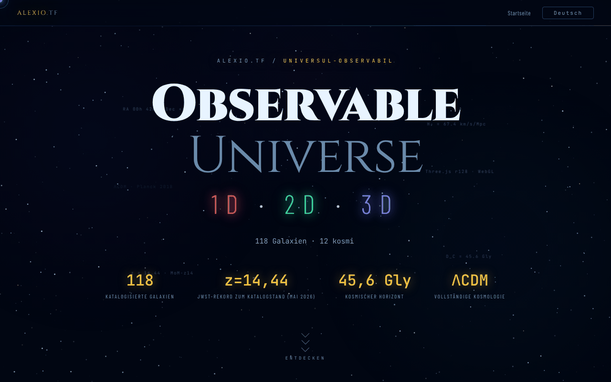

# Observable Universe — 1D · 2D · 3D

[English](README.md) · [Română](README.ro.md) · [Français](README.fr.md) · [Italiano](README.it.md) · [Español](README.es.md) · [Português](README.pt.md) · **Deutsch** · [Magyar](README.hu.md)

**Version:** 2.1.2 · **Zuletzt aktualisiert:** 2026-10-28

**Status:** stabil · **Offline:** vollständig (eine einzelne Datei; die drei Apps werden über die Links gestartet)

Oberflächensprachen: **Română, English, Français, Italiano, Español, Português (PT), Deutsch, Magyar**

Einstiegsseite, die die drei Versionen (1D, 2D, 3D) der Visualisierung des beobachtbaren Universums vorstellt und vergleicht.

**Online:** https://chiuta.github.io/Universul-Observabil/

## Was es ist

Diese HTML-Datei ist die Hub-Seite der Serie „Observable Universe": Sie enthält die Visualisierungen nicht selbst (sie hat nur einen kleinen Offline-Kosmologie-Rechner), sondern stellt sie vor, vergleicht sie und verweist auf sie. Die drei Versionen laut Beschreibung auf der Seite:

- 1D (v2.1.2, „Radialachse"): 112 Galaxien auf einer einzigen Achse, mit vier Achsenmodi (Rückblickzeit, mitbewegte Entfernung, Rotverschiebung z, Skalenfaktor); ca. 160 KB.
- 2D (v6.2.2, „Flache Karte"): 12 kosmische Horizonte, adaptives Zoomen, Permalink mit Zustand, Quiz mit Bestenliste; ca. 550 KB.
- 3D (v2.1.1, „Realer Raum"): echte RA/Dek-Koordinaten, ΛCDM-Kosmologie, H₀-Auswahl (Planck 67,4 vs. SH0ES 73,0), WebGL mit Three.js r128; ca. 1 MB.

Die Seite nennt einen im Mai 2026 aktualisierten Katalog und MoM-z14 (z = 14,44, spektroskopisch mit dem JWST bestätigt; Naidu et al. 2025) als Entfernungsrekord **zum Katalogdatum (Mai 2026)**; wir garantieren nicht, dass er danach Rekord bleibt. Die obigen Angaben sind die von der Seite deklarierten und wurden hier nicht überprüft.

## Funktionen

- „Wie weit, wie lange her?": Offline-Kosmologie-Rechner (z zwischen 0 und 20, H₀ = 67,4 Planck oder 73,0 SH0ES), der die Rückblickzeit, die mitbewegte Entfernung, das Alter des Universums zum Zeitpunkt der Emission, den Skalenfaktor a = 1/(1+z), die Leuchtkraftentfernung D_L = (1+z)·D_C und die Winkeldurchmesserentfernung D_A = D_C/(1+z) liefert (D_L und D_A folgen aus den Definitionen; bei z = 1: D_L = 22,19 Mrd. Lj, D_A = 5,55 Mrd. Lj); flaches ΛCDM-Modell mit Ωm = 0,315, Strahlung vernachlässigt (Richtwerte; geprüft gegen eine unabhängige Integration, z. B. z = 1 → 7,95 Mrd. Jahre und 3,40 Gpc bei H₀ = 67,4).
- Vorstellung der drei Versionen, mit „Starten"-Schaltflächen und Links zu den Kopien auf GitHub („GitHub mirror").
- Vergleichstabelle nach Kategorien (Visualisierung, Kosmologie, UX und Export, Technik) für 1D / 2D / 3D.
- Sprachwähler (RO, EN, FR, IT, ES, PT, DE, HU) in der Ecke der Seite.
- Buy-Me-a-Coffee-Links.

## Bedienungsanleitung

1. Lies die Vorstellung und die Vergleichstabelle, um eine Version auszuwählen.
2. Drücke „🔭 3D starten (empfohlen)", „🌐 2D-Version" oder „📡 1D-Version"; jede öffnet sich in einem neuen Tab auf alexio.tf.
3. Alternativ nutze die Links „GITHUB MIRRORS" 1D / 2D / 3D zu den Kopien auf chiuta.github.io.
4. Wechsle die Sprache mit der Schaltfläche EN / RO.

## Datenschutz und Netzwerk

- In `localStorage` wird nur die gewählte Sprache (`universul-observabil.lang`) gespeichert.
- Die Seite stellt keine automatischen Netzwerkanfragen (kein `fetch`, keine externen Skripte oder Stile). Die Links führen beim Anklicken zu alexio.tf, chiuta.github.io, Buy Me a Coffee und den im Fußbereich angezeigten Partnerseiten (darunter centrulstring.ro).
- Die gestarteten Versionen sind eigenständige Anwendungen mit eigener Richtlinie; sie werden hier nicht analysiert.

## Lokale Ausführung / offline

Lade `index.html` herunter und öffne sie im Browser: Die Seite wird ohne Internet angezeigt, aber die Start-Schaltflächen und die Mirrors benötigen eine Verbindung, da sie auf online gehostete Seiten verweisen.

## Katalog-Größen in der Serie (2.0.1)

- **Zahlen.** Hub: 112 Einträge (identische Kopie des 1D-Katalogs). 1D: 112. 2D: 112 (111 Galaxien + der CMB-Horizont; manche Texte sagen 111). 3D: 118 („über 115“ in den Beschreibungen). Die Zahlen unterscheiden sich, weil die Kataloge getrennt sind, nicht wegen eines Zählfehlers.
- **Nicht vereinheitlicht.** 3D hat einen eigenen Katalog mit anderer Struktur (RA in Stunden, andere Namen und Schreibweisen), seine Namen stimmen daher nur teilweise mit 1D/2D überein. Eine Zusammenführung in eine gemeinsame Datei erfolgte nicht: Jede App ist eine einzelne Offline-Datei ohne gemeinsamen Build-Schritt, und ein Zusammenführen würde Daten in drei Apps ändern, ohne sie hier validieren zu können. Dem Autor gemeldet.
- **Konflikt 1D ↔ 2D (gelöst am 2026-10-28; Quellen und Formeln in `docs/DISCREPANTE.md` des Hubs).** Die 8 Entfernungen (NGC 1132, IC 310, 3C 48, Abell 370, CL 0024+1654, SDSS J1004+4112, IC 4296, Abell 1689) folgen jetzt in beiden Apps einer Konvention: d = lb = lookback(z), in Mio. Lj, flaches ΛCDM Planck 2018 (H₀ = 67,4, Ωm = 0,315), mit von mindestens 2 Quellen bestätigtem z; 2D übernahm die 1D-Werte (330, 270, 4150, 4200, 4400, 10050, 180, 2330). Die Rotverschiebung von Andromeda (M31) ist in beiden −0,001 (M31 ist blauverschoben, −301 km/s). Die Bezeichnung „Perseus (BCG IC 310)“ wurde zu „IC 310 (Perseus)“: IC 310 ist nicht die hellste Galaxie des Haufens (das ist NGC 1275, ein eigener Eintrag).

## Real versions and discrepancies (2.1.0)

_(English only; not yet translated into this language. Machine translation intentionally not added to avoid errors in technical statements.)_

- **Card labels** ("v2.1.0 · 112", "v6.2.0 · 112", "v2.1.0 · 118") are no longer stale translation keys: the numbers come from one constant (`UO_APPS`), checked by `tests/versions.test.mjs` against `application-version` in the 1D/2D/3D repositories and against the real entry counts.
- **Catalogue copy** in the hub is compared with 1D (fields `n, ra, dec, d, t, z, lb`): identical.
- **1D ↔ 2D discrepancies** (8 distances and the sign of Andromeda's z) are now in a generated table, `docs/DISCREPANTE.md` (`node tools/compare-catalogs.mjs <1D> <2D> --md docs/DISCREPANTE.md`). **No value was chosen:** NED/SIMBAD were not reachable in the session. The table also shows an internal arithmetic check (the 1D values match the lookback computed from the catalogue's own z; the 2D ones do not), which is **not a source**.
- **Merging the catalogues into one shared file: not done**; it would have required picking one of the conflicting values.

## Verlauf / Changelog

### 2.1.2 — 2026-10-28
- Die Hub-Kopie folgt 1D (7 Entfernungen, NGC 1277, „Abell 2744 (Pandora)“); `docs/DISCREPANTE.md` neu erzeugt; `tests/catalog-consistency.test.mjs` erweitert (Quellen, unveränderte Einträge, Audit z > 0,01); die Karten zeigen 1D 2.1.2 / 2D 6.2.2 / 3D 2.1.1.

### 2.1.1 — 2026-10-28
- Katalogkorrekturen: Die Hub-Kopie folgt 1D (Bezeichnung „IC 310 (Perseus)“); die 8 Entfernungen und das Vorzeichen von Andromedas z sind mit Quellen in `docs/DISCREPANTE.md` gelöst (Generator `tools/compare-catalogs.mjs`); neuer Test `tests/catalog-consistency.test.mjs`; die Karten zeigen 1D 2.1.1 / 2D 6.2.1 / 3D 2.1.1.

### 2.1.0 — 2026-10-27
- Labels with the real version, version test, `docs/DISCREPANTE.md`.

### 1.2.8 — 2026-10-23
- `prefers-reduced-motion` wird jetzt auch von den JavaScript-Animationen beachtet (Nebel, Sternfunkeln, Klick-Partikel, Tippeffekt, Karten-Neigung, Cursor-Folgen, Zähler); zuvor wurden nur die CSS-Animationen reduziert.
- Kosmischer Rechner: Nur einfache Dezimalzahlen werden akzeptiert (`0x10`, `1e1`, `0b11` werden nicht mehr als Zahlen gelesen).
- Auf Touchscreens (`pointer: coarse`) haben Links, Sprachauswahl, Chips und Tabs ein Touch-Ziel von 44 px.

### 1.2.7 — 2026-10-23
- fff-kit 1.2.0: Die Sprache wird jetzt unter dem Schlüssel `universul-observabil.lang` gespeichert; der alte Schlüssel `uo_lang` wird beim Start automatisch migriert (auch nach dem Import einer alten .fff.json-Sicherung). Der Versionstext in der Fußzeile folgt jetzt in allen Sprachen der tatsächlichen Version.

### 1.2.5 — 2026-10-22
- fff-kit 1.1.4: Touch-Ziele und Mindestschriftgröße; Touch-Ziele/Text korrigiert

### 1.2.4 — 2026-10-22
- fff-kit 1.1.2: PBKDF2 mit 600.000 Iterationen, Schutz vor Clickjacking.

### 1.2.3 — 2026-10-22
- Mobil: Der Text ist mindestens 12 px groß, und Schaltflächen und Felder haben auf schmalen Bildschirmen größere Touch-Flächen.

- 1.2.2 — 2026-10-22: Übersetzungskorrektur: Beschreibung (und Name) im Transparenzfenster folgen jetzt der Oberflächensprache.
- 1.2.1 — 2026-10-22: Der Seitentitel folgt jetzt der Oberflächensprache (<title> wird beim Sprachwechsel aktualisiert).

- 1.1.0 — 2026-10-14: Datensicherung und Datenkennzeichnung (fff-kit).

- 1.0.0 — 2026-10-12: Version und Datum der letzten Aktualisierung werden in der App angezeigt
- Runde 7: Der Kosmologie-Rechner liefert nun auch den Skalenfaktor, die Leuchtkraftentfernung und die Winkeldurchmesserentfernung (RO/EN); Dateigröße von ~616 KB auf ~461 KB reduziert durch Entfernen von 8 ungenutzten @font-face-Deklarationen (Barlow 300/500/300 kursiv und JetBrains Mono 300), geprüft durch Screenshot-Vergleich und Auflistung der berechneten Schriften; kein Inhaltsverlust.
- Offline-Kosmologie-Rechner hinzugefügt; horizontaler Überlauf von 2 px (die Trennlinie) beseitigt; die dekorativen schwebenden Beschriftungen im Kopfbereich sind jetzt generierter Inhalt (sie verursachen keine Kontrastschwankungen mehr in axe-core); CSP: `script-src` per SHA-256-Hash, ohne `'unsafe-inline'`.
- Die Anzahl der Galaxien ist jetzt konsistent: 1D und 2D = 112, 3D und Gesamtkatalog = 118 (zuvor stand in der Tabelle „115+" und im Kopfbereich 118).
- Ein sichtbarer Hinweis ergänzt, dass die Seite nur der Präsentation dient und der Start der Versionen Internet erfordert.
- Der Hauptinhalt steht in `<main>`, dekorative Elemente sind für Screenreader verborgen, die Vergleichstabelle und die Tabs laufen bei 360 px nicht mehr über den Bildschirm hinaus, und der Kontrast der abgeblendeten Beschriftungen wurde erhöht; axe-core: 0 Verstöße bei 1280 und 360 px.
- Der Rekord MoM-z14 (z = 14,44) bleibt als „zum Katalogdatum (Mai 2026)" formuliert; bei der Suche vom 11.10.2026 fanden wir keine spätere spektroskopische Bestätigung, die ihn übertrifft, die datierte Formulierung wurde jedoch bewusst beibehalten. Am 11.10.2026 geprüfte Quellen: arXiv 2505.11263 (Naidu et al.).

## Lizenz

MIT — siehe Datei LICENSE

## Audit

Audit: 2026-10-10; Runde 3: 2026-10-11 — zeitlich begrenzte Aussagen („JWST-Rekord 2026") umformuliert in „zum Katalogdatum (Mai 2026)" mit Quellenangabe; Verweis auf „Zenodo-DOI" aus der 3D-Beschreibung entfernt (die 3D-App hat keine DOI).

## Autor

Alexio — Alexandru-Ionuț Chiuță, Kontakt: alexio@trom.tf. Der Seitenfuß verweist auch auf das Centrul StrING.

## Zusammenfassung

Eine Einstiegsseite in einer einzigen Datei für die Serie „Observable Universe", die ihre 1D-, 2D- und 3D-Versionen (Radialachse, flache Karte, WebGL-Ansicht im realen Raum) mit Startlinks und GitHub-Mirrors vorstellt und vergleicht, in 8 Sprachen, plus ein kleiner Offline-Kosmologie-Rechner (Rotverschiebung, Rückblickzeit und mitbewegte Entfernung). Sie speichert lokal nur die Sprachwahl und stellt keine automatischen Netzwerkanfragen; Start- und Mirror-Links öffnen externe Seiten.
