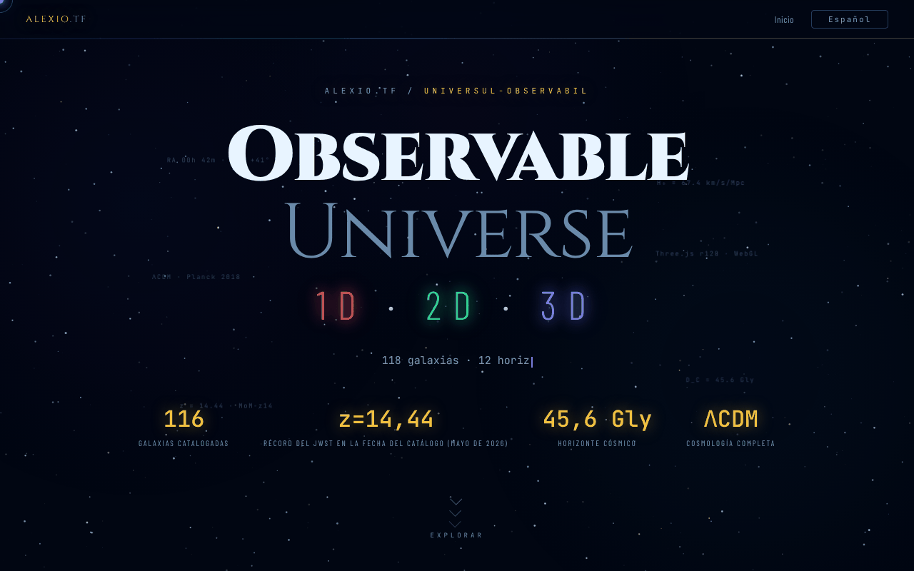

# Observable Universe — 1D · 2D · 3D

[English](README.md) · [Română](README.ro.md) · [Français](README.fr.md) · [Italiano](README.it.md) · **Español** · [Português](README.pt.md) · [Deutsch](README.de.md) · [Magyar](README.hu.md)

**Versión:** 2.1.1 · **Última actualización:** 2026-10-28

**Estado:** estable · **Sin conexión:** completo (un solo archivo; las tres aplicaciones se abren desde los enlaces)

Idiomas de la interfaz: **Română, English, Français, Italiano, Español, Português (PT), Deutsch, Magyar**

Página de entrada que presenta y compara las tres versiones (1D, 2D, 3D) de la visualización del Universo observable.

**En línea:** https://chiuta.github.io/Universul-Observabil/

## Qué es

Este archivo HTML es la página principal de la serie «Observable Universe»: no contiene las visualizaciones en sí (solo tiene una pequeña calculadora cosmológica sin conexión), sino que las presenta, las compara y enlaza a ellas. Las tres versiones, según la descripción de la página:

- 1D (v2.1.1, «Eje radial»): 112 galaxias en un solo eje, con cuatro modos de eje (tiempo de retrospección, distancia comóvil, corrimiento al rojo z, factor de escala); aprox. 160 KB.
- 2D (v6.2.1, «Mapa plano»): 12 horizontes cósmicos, zoom adaptativo, enlace permanente con estado, cuestionario con clasificación; aprox. 550 KB.
- 3D (v2.1.1, «Espacio real»): coordenadas AR/Dec reales, cosmología ΛCDM, selector de H₀ (Planck 67,4 frente a SH0ES 73,0), WebGL con Three.js r128; aprox. 1 MB.

La página indica un catálogo actualizado en mayo de 2026 y MoM-z14 (z = 14,44, confirmado espectroscópicamente con el JWST; Naidu et al. 2025) como récord de distancia **a la fecha del catálogo (mayo de 2026)**; no garantizamos que siga siendo récord después. Las cifras anteriores son las que declara la página, no verificadas aquí.

## Funciones

- «¿Cuán lejos, hace cuánto tiempo?»: calculadora cosmológica sin conexión (z entre 0 y 20, H₀ = 67,4 Planck o 73,0 SH0ES) que da el tiempo de retrospección, la distancia comóvil, la edad del Universo en la emisión, el factor de escala a = 1/(1+z), la distancia de luminosidad D_L = (1+z)·D_C y la distancia de diámetro angular D_A = D_C/(1+z) (D_L y D_A se deducen de las definiciones; para z = 1: D_L = 22,19 Gal, D_A = 5,55 Gal); modelo ΛCDM plano con Ωm = 0,315, radiación despreciada (valores orientativos; contrastado con una integración independiente, p. ej. z = 1 → 7,95 Ga y 3,40 Gpc con H₀ = 67,4).
- Presentación de las tres versiones, con botones «Lanzar» y enlaces a las copias en GitHub («GitHub mirror»).
- Tabla comparativa por categorías (visualización, cosmología, UX y exportación, técnica) para 1D / 2D / 3D.
- Selector de idioma (RO, EN, FR, IT, ES, PT, DE, HU) en la esquina de la página.
- Enlaces a Buy Me a Coffee.

## Guía de uso

1. Lee la presentación y la tabla comparativa para elegir una versión.
2. Pulsa «🔭 Lanzar 3D (recomendada)», «🌐 Versión 2D» o «📡 Versión 1D»; cada una se abre en una pestaña nueva en alexio.tf.
3. Como alternativa, usa los enlaces «GITHUB MIRRORS» 1D / 2D / 3D a las copias en chiuta.github.io.
4. Cambia el idioma con el botón EN / RO.

## Privacidad y red

- En `localStorage` solo se guarda el idioma elegido (`universul-observabil.lang`).
- La página no realiza solicitudes de red automáticas (sin `fetch`, ni scripts ni estilos externos). Los enlaces llevan, al hacer clic, a alexio.tf, chiuta.github.io, Buy Me a Coffee y los sitios asociados que aparecen en el pie de página (entre ellos centrulstring.ro).
- Las versiones lanzadas son aplicaciones independientes, con su propia política; aquí no se analizan.

## Ejecución local / sin conexión

Descarga `index.html` y ábrelo en el navegador: la página se muestra sin internet, pero los botones de lanzamiento y los espejos requieren conexión, porque remiten a páginas alojadas en línea.

## Tamaño de los catálogos en la serie (2.0.1)

- **Cifras.** Hub: 112 entradas (copia idéntica del catálogo 1D). 1D: 112. 2D: 112 (111 galaxias + el horizonte del CMB; algunos textos dicen 111). 3D: 118 («más de 115» en las descripciones). Las cifras difieren porque los catálogos son independientes, no por un error de recuento.
- **No unificados.** La 3D tiene su propio catálogo, con otra estructura (AR en horas, otros nombres y grafías), por lo que sus nombres solo coinciden en parte con 1D/2D. No se fusionaron en un único archivo común: cada aplicación es un archivo único sin conexión y sin paso de compilación común, y fusionar cambiaría los datos de tres aplicaciones sin forma de validarlos aquí. Señalado al autor.
- **Conflicto 1D ↔ 2D (resuelto el 2026-10-28; fuentes y fórmulas en `docs/DISCREPANTE.md` del hub).** Las 8 distancias (NGC 1132, IC 310, 3C 48, Abell 370, CL 0024+1654, SDSS J1004+4112, IC 4296, Abell 1689) siguen ahora una única convención en ambas aplicaciones: d = lb = lookback(z), en Mal, ΛCDM plano Planck 2018 (H₀ = 67,4, Ωm = 0,315), con z confirmado por al menos 2 fuentes; la 2D adoptó los valores de la 1D (330, 270, 4150, 4200, 4400, 10050, 180, 2330). El corrimiento al rojo de Andrómeda (M31) es −0,001 en ambas (M31 está desplazada hacia el azul, −301 km/s). La etiqueta «Perseus (BCG IC 310)» pasó a ser «IC 310 (Perseus)»: IC 310 no es la galaxia más brillante del cúmulo (esa es NGC 1275, entrada aparte).

## Real versions and discrepancies (2.1.0)

_(English only; not yet translated into this language. Machine translation intentionally not added to avoid errors in technical statements.)_

- **Card labels** ("v2.1.0 · 112", "v6.2.0 · 112", "v2.1.0 · 118") are no longer stale translation keys: the numbers come from one constant (`UO_APPS`), checked by `tests/versions.test.mjs` against `application-version` in the 1D/2D/3D repositories and against the real entry counts.
- **Catalogue copy** in the hub is compared with 1D (fields `n, ra, dec, d, t, z, lb`): identical.
- **1D ↔ 2D discrepancies** (8 distances and the sign of Andromeda's z) are now in a generated table, `docs/DISCREPANTE.md` (`node tools/compare-catalogs.mjs <1D> <2D> --md docs/DISCREPANTE.md`). **No value was chosen:** NED/SIMBAD were not reachable in the session. The table also shows an internal arithmetic check (the 1D values match the lookback computed from the catalogue's own z; the 2D ones do not), which is **not a source**.
- **Merging the catalogues into one shared file: not done**; it would have required picking one of the conflicting values.

## Historial / Changelog

### 2.1.1 — 2026-10-28
- Correcciones del catálogo: la copia del hub sigue a la 1D (etiqueta «IC 310 (Perseus)»); las 8 distancias y el signo del z de Andrómeda se resuelven con fuentes en `docs/DISCREPANTE.md` (generador `tools/compare-catalogs.mjs`); nuevo test `tests/catalog-consistency.test.mjs`; las tarjetas muestran 1D 2.1.1 / 2D 6.2.1 / 3D 2.1.1.

### 2.1.0 — 2026-10-27
- Labels with the real version, version test, `docs/DISCREPANTE.md`.

### 1.2.8 — 2026-10-23
- `prefers-reduced-motion` ahora también lo respetan las animaciones de JavaScript (nebulosa, centelleo de estrellas, partículas al hacer clic, efecto de escritura, inclinación de tarjetas, seguimiento del cursor, contador); antes solo se reducían las animaciones CSS.
- Calculadora cósmica: solo se aceptan decimales simples (`0x10`, `1e1`, `0b11` ya no se leen como números).
- En pantallas táctiles (`pointer: coarse`) los enlaces, el selector de idioma, los chips y las pestañas tienen un área táctil de 44 px.

### 1.2.7 — 2026-10-23
- fff-kit 1.2.0: el idioma se guarda ahora con la clave `universul-observabil.lang`; la antigua clave `uo_lang` se migra automáticamente al iniciar (también tras importar una copia .fff.json antigua). El texto de la versión del pie de página sigue ahora la versión real en todos los idiomas.

### 1.2.5 — 2026-10-22
- fff-kit 1.1.4: objetivos táctiles y texto mínimo; objetivos táctiles/texto corregidos

### 1.2.4 — 2026-10-22
- fff-kit 1.1.2: PBKDF2 con 600.000 iteraciones, protección anti-clickjacking.

### 1.2.3 — 2026-10-22
- Móvil: el texto mide al menos 12 px y los botones y campos tienen áreas táctiles mayores en pantallas estrechas.

- 1.2.2 — 2026-10-22: Corrección de traducción: la descripción (y el nombre) del panel de transparencia siguen ahora el idioma de la interfaz.
- 1.2.1 — 2026-10-22: el título de la página sigue ahora el idioma de la interfaz (<title> se actualiza al cambiar de idioma).

- 1.1.0 — 2026-10-14: copia de seguridad y etiquetado de datos (fff-kit).

- 1.0.0 — 2026-10-12: la versión y la fecha de la última actualización se muestran en la aplicación
- Ronda 7: la calculadora cosmológica ofrece ahora también el factor de escala, la distancia de luminosidad y la distancia de diámetro angular (RO/EN); tamaño del archivo reducido de ~616 KB a ~461 KB al eliminar 8 declaraciones @font-face sin usar (Barlow 300/500/300 cursiva y JetBrains Mono 300), verificado mediante comparación de capturas y enumeración de las fuentes calculadas; sin pérdida de contenido.
- Añadida la calculadora cosmológica sin conexión; eliminado el desbordamiento horizontal de 2 px (la línea separadora); las etiquetas flotantes decorativas de la cabecera son ahora contenido generado (ya no provocan fluctuaciones de contraste en axe-core); CSP: `script-src` mediante hash SHA-256, sin `'unsafe-inline'`.
- El número de galaxias es ahora coherente: 1D y 2D = 112, 3D y catálogo total = 118 (antes la tabla decía «115+» y la cabecera 118).
- Añadida una nota visible de que la página es solo de presentación y de que lanzar las versiones requiere internet.
- El contenido principal está en `<main>`, los elementos decorativos se ocultan a los lectores de pantalla, la tabla comparativa y las pestañas ya no se salen de la pantalla a 360 px y se ha aumentado el contraste de las etiquetas atenuadas; axe-core: 0 infracciones a 1280 y 360 px.
- El récord MoM-z14 (z = 14,44) sigue formulado «a la fecha del catálogo (mayo de 2026)»; en la búsqueda del 11.10.2026 no encontramos una confirmación espectroscópica posterior que lo supere, pero la formulación con fecha se mantuvo intencionadamente. Fuentes verificadas el 11.10.2026: arXiv 2505.11263 (Naidu et al.).

## Licencia

MIT — véase el archivo LICENSE

## Auditoría

Auditoría: 2026-10-10; ronda 3: 2026-10-11 — afirmaciones perecederas («Récord JWST 2026») reformuladas «a la fecha del catálogo (mayo de 2026)» con la fuente; eliminada la referencia al «DOI de Zenodo» de la descripción del 3D (la aplicación 3D no tiene DOI).

## Autor

Alexio — Alexandru-Ionuț Chiuță, contacto: alexio@trom.tf. El pie de página también enlaza con el Centrul StrING.

## Resumen

Página de entrada de un solo archivo para la serie «Observable Universe», que presenta y compara sus versiones 1D, 2D y 3D (eje radial, mapa plano, vista WebGL en espacio real) con enlaces de lanzamiento y espejos de GitHub, en 8 idiomas, además de una pequeña calculadora cosmológica sin conexión (corrimiento al rojo, tiempo de retrospección y distancia comóvil). Solo guarda localmente la elección del idioma y no realiza solicitudes de red automáticas; los enlaces de lanzamiento y de espejo abren páginas externas.
