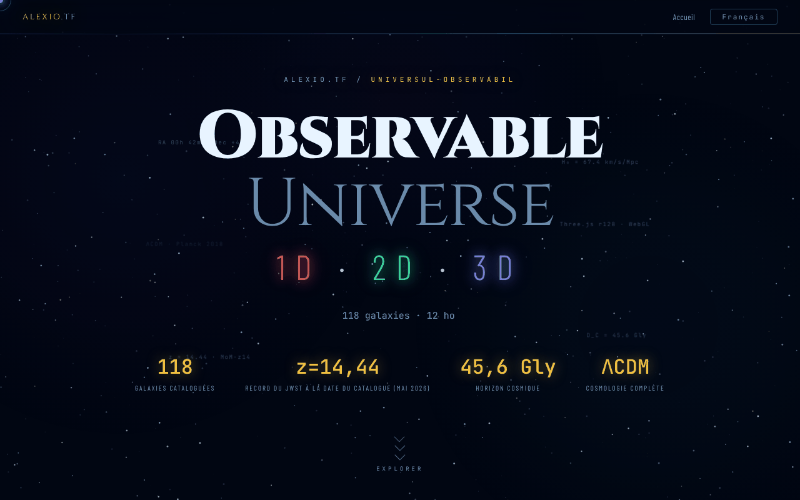

# Observable Universe — 1D · 2D · 3D

[English](README.md) · [Română](README.ro.md) · **Français** · [Italiano](README.it.md) · [Español](README.es.md) · [Português](README.pt.md) · [Deutsch](README.de.md) · [Magyar](README.hu.md)

**Version :** 2.1.0 · **Dernière mise à jour :** 2026-10-27

**État :** stable · **Hors ligne :** complet (un seul fichier ; les trois applications se lancent depuis les liens)

Langues de l'interface : **Română, English, Français, Italiano, Español, Português (PT), Deutsch, Magyar**

Page d'accueil qui présente et compare les trois versions (1D, 2D, 3D) de la visualisation de l'Univers observable.

**En ligne :** https://chiuta.github.io/Universul-Observabil/

## De quoi s'agit-il

Ce fichier HTML est la page-hub de la série « Observable Universe » : il ne contient pas les visualisations elles-mêmes (il n'a qu'un petit calculateur cosmologique hors ligne), mais les présente, les compare et renvoie vers elles. Les trois versions, d'après la description de la page :

- 1D (v2.1.0, « Axe radial ») : 112 galaxies sur un seul axe, avec quatre modes d'axe (temps de regard en arrière, distance comobile, décalage vers le rouge z, facteur d'échelle) ; env. 160 Ko.
- 2D (v6.2.0, « Carte plane ») : 12 horizons cosmiques, zoom adaptatif, permalien avec état, quiz avec classement ; env. 550 Ko.
- 3D (v2.1.0, « Espace réel ») : coordonnées AD/Déc réelles, cosmologie ΛCDM, sélecteur de H₀ (Planck 67,4 contre SH0ES 73,0), WebGL avec Three.js r128 ; env. 1 Mo.

La page indique un catalogue mis à jour en mai 2026 et MoM-z14 (z = 14,44, confirmé spectroscopiquement par le JWST ; Naidu et al. 2025) comme record de distance **à la date du catalogue (mai 2026)** ; nous ne garantissons pas qu'il reste un record par la suite. Les chiffres ci-dessus sont ceux que déclare la page, non vérifiés ici.

## Fonctionnalités

- « À quelle distance, il y a combien de temps ? » : calculateur cosmologique hors ligne (z entre 0 et 20, H₀ = 67,4 Planck ou 73,0 SH0ES) qui donne le temps de regard en arrière, la distance comobile, l'âge de l'Univers à l'émission, le facteur d'échelle a = 1/(1+z), la distance de luminosité D_L = (1+z)·D_C et la distance de diamètre angulaire D_A = D_C/(1+z) (D_L et D_A découlent des définitions ; pour z = 1 : D_L = 22,19 Gal, D_A = 5,55 Gal) ; modèle ΛCDM plat avec Ωm = 0,315, rayonnement négligé (valeurs indicatives ; vérifié par rapport à une intégration indépendante, p. ex. z = 1 → 7,95 Ga et 3,40 Gpc pour H₀ = 67,4).
- Présentation des trois versions, avec des boutons « Lancer » et des liens vers les copies sur GitHub (« GitHub mirror »).
- Tableau comparatif par catégories (visualisation, cosmologie, UX et export, technique) pour 1D / 2D / 3D.
- Sélecteur de langue (RO, EN, FR, IT, ES, PT, DE, HU) dans le coin de la page.
- Liens Buy Me a Coffee.

## Mode d'emploi

1. Lisez la présentation et le tableau comparatif pour choisir une version.
2. Appuyez sur « 🔭 Lancer la 3D (recommandé) », « 🌐 Version 2D » ou « 📡 Version 1D » ; chacune s'ouvre dans un nouvel onglet sur alexio.tf.
3. Vous pouvez aussi utiliser les liens « GITHUB MIRRORS » 1D / 2D / 3D vers les copies sur chiuta.github.io.
4. Changez de langue avec le bouton EN / RO.

## Confidentialité et réseau

- Seule la langue choisie (`universul-observabil.lang`) est conservée dans `localStorage`.
- La page n'effectue aucune requête réseau automatique (pas de `fetch`, ni de scripts ou styles externes). Les liens mènent, au clic, vers alexio.tf, chiuta.github.io, Buy Me a Coffee et les sites partenaires affichés en pied de page (dont centrulstring.ro).
- Les versions lancées sont des applications distinctes, avec leur propre politique ; elles ne sont pas analysées ici.

## Exécution en local / hors ligne

Téléchargez `index.html` et ouvrez-le dans un navigateur : la page s'affiche sans internet, mais les boutons de lancement et les miroirs nécessitent une connexion, car ils renvoient vers des pages hébergées en ligne.

## Taille des catalogues dans la série (2.0.1)

- **Chiffres.** Hub : 112 entrées (copie identique du catalogue 1D). 1D : 112. 2D : 112 (111 galaxies + l'horizon du CMB ; certains textes disent 111). 3D : 118 (« plus de 115 » dans les descriptions). Les chiffres diffèrent parce que les catalogues sont séparés, non par erreur de comptage.
- **Non unifiés.** La 3D a son propre catalogue, de structure différente (AD en heures, autres noms et graphies), ses noms ne correspondent donc que partiellement à ceux de 1D/2D. La fusion en un fichier commun n'a pas été faite : chaque application est un fichier unique hors ligne sans étape de build commune, et fusionner changerait les données de trois applications sans moyen de les valider ici. Signalé à l'auteur.
- **Conflit connu 1D ↔ 2D (non corrigé, à vérifier avec des sources).** Les deux catalogues ont les mêmes 112 noms, mais 8 entrées ont une distance différente (d = temps de regard en arrière, en Mal, 1D→2D) : NGC 1132 330→1020, Perseus (BCG IC 310) 270→780, 3C 48 4150→5200, Abell 370 4200→5900, CL 0024+1654 4400→5500, SDSS J1004+4112 10050→7000, IC 4296 180→130, Abell 1689 2330→7200 ; et le signe du décalage vers le rouge d'Andromède (M31) est −0,001 en 1D et +0,001 en 2D.

## Real versions and discrepancies (2.1.0)

_(English only; not yet translated into this language. Machine translation intentionally not added to avoid errors in technical statements.)_

- **Card labels** ("v2.1.0 · 112", "v6.2.0 · 112", "v2.1.0 · 118") are no longer stale translation keys: the numbers come from one constant (`UO_APPS`), checked by `tests/versions.test.mjs` against `application-version` in the 1D/2D/3D repositories and against the real entry counts.
- **Catalogue copy** in the hub is compared with 1D (fields `n, ra, dec, d, t, z, lb`): identical.
- **1D ↔ 2D discrepancies** (8 distances and the sign of Andromeda's z) are now in a generated table, `docs/DISCREPANTE.md` (`node tools/compare-catalogs.mjs <1D> <2D> --md docs/DISCREPANTE.md`). **No value was chosen:** NED/SIMBAD were not reachable in the session. The table also shows an internal arithmetic check (the 1D values match the lookback computed from the catalogue's own z; the 2D ones do not), which is **not a source**.
- **Merging the catalogues into one shared file: not done**; it would have required picking one of the conflicting values.

## Historique / Changelog

### 2.1.0 — 2026-10-27
- Labels with the real version, version test, `docs/DISCREPANTE.md`.

### 1.2.8 — 2026-10-23
- `prefers-reduced-motion` est désormais respecté aussi par les animations JavaScript (nébuleuse, scintillement des étoiles, particules au clic, effet de frappe, inclinaison des cartes, suivi du curseur, compteur) ; avant, seules les animations CSS étaient réduites.
- Calculateur cosmique : seuls les décimaux simples sont acceptés (`0x10`, `1e1`, `0b11` ne sont plus lus comme des nombres).
- Sur écrans tactiles (`pointer: coarse`), liens, sélecteur de langue, puces et onglets ont une cible tactile de 44 px.

### 1.2.7 — 2026-10-23
- fff-kit 1.2.0 : la langue est désormais conservée sous la clé `universul-observabil.lang` ; l'ancienne clé `uo_lang` est migrée automatiquement au démarrage (y compris après l'import d'une ancienne sauvegarde .fff.json). Le texte de version du pied de page suit désormais la version réelle dans toutes les langues.

### 1.2.5 — 2026-10-22
- fff-kit 1.1.4 : cibles tactiles et taille de texte minimale; cibles tactiles/texte corrigés

### 1.2.4 — 2026-10-22
- fff-kit 1.1.2 : PBKDF2 à 600 000 itérations, protection anti-clickjacking.

### 1.2.3 — 2026-10-22
- Mobile : le texte fait au moins 12 px et les boutons et champs ont des cibles tactiles plus grandes sur les écrans étroits.

- 1.2.2 — 2026-10-22: Correctif de traduction : la description (et le nom) du panneau de transparence suivent désormais la langue de l'interface.
- 1.2.1 — 2026-10-22: le titre de la page suit désormais la langue de l'interface (<title> mis à jour au changement de langue).

- 1.1.0 — 2026-10-14 : sauvegarde et étiquetage des données (fff-kit).

- 1.0.0 — 2026-10-12 : la version et la date de la dernière mise à jour sont affichées dans l'application
- Série 7 : le calculateur cosmologique fournit désormais aussi le facteur d'échelle, la distance de luminosité et la distance de diamètre angulaire (RO/EN) ; taille du fichier réduite de ~616 Ko à ~461 Ko par suppression de 8 déclarations @font-face inutilisées (Barlow 300/500/300 italique et JetBrains Mono 300), vérifiée par comparaison de captures et énumération des polices calculées ; sans perte de contenu.
- Ajout du calculateur cosmologique hors ligne ; suppression du débordement horizontal de 2 px (la ligne de séparation) ; les étiquettes flottantes décoratives de l'en-tête sont désormais du contenu généré (elles ne provoquent plus de fluctuations de contraste dans axe-core) ; CSP : `script-src` par empreinte SHA-256, sans `'unsafe-inline'`.
- Le nombre de galaxies est désormais cohérent : 1D et 2D = 112, 3D et catalogue total = 118 (auparavant, le tableau indiquait « 115+ » et l'en-tête 118).
- Ajout d'une note visible précisant que la page n'est qu'une présentation et que le lancement des versions nécessite internet.
- Le contenu principal se trouve dans `<main>`, les éléments décoratifs sont masqués aux lecteurs d'écran, le tableau comparatif et les onglets ne dépassent plus de l'écran à 360 px, et le contraste des étiquettes atténuées a été augmenté ; axe-core : 0 violation à 1280 et 360 px.
- Le record MoM-z14 (z = 14,44) reste formulé « à la date du catalogue (mai 2026) » ; dans la recherche du 11.10.2026, nous n'avons trouvé aucune confirmation spectroscopique ultérieure qui le dépasse, mais la formulation datée a été conservée volontairement. Sources vérifiées le 11.10.2026 : arXiv 2505.11263 (Naidu et al.).

## Licence

MIT — voir le fichier LICENSE

## Audit

Audit : 2026-10-10 ; série 3 : 2026-10-11 — affirmations périssables (« Record JWST 2026 ») reformulées « à la date du catalogue (mai 2026) » avec la source ; suppression de la mention du « DOI Zenodo » dans la description de la 3D (l'application 3D n'a pas de DOI).

## Auteur

Alexio — Alexandru-Ionuț Chiuță, contact : alexio@trom.tf. Le pied de page renvoie aussi vers le Centrul StrING.

## Résumé

Page d'accueil en un seul fichier pour la série « Observable Universe », qui présente et compare ses versions 1D, 2D et 3D (axe radial, carte plane, vue WebGL en espace réel) avec des liens de lancement et des miroirs GitHub, en 8 langues, ainsi qu'un petit calculateur cosmologique hors ligne (décalage vers le rouge, temps de regard en arrière et distance comobile). Elle ne conserve localement que le choix de la langue et n'effectue aucune requête réseau automatique ; les liens de lancement et de miroir ouvrent des pages externes.
