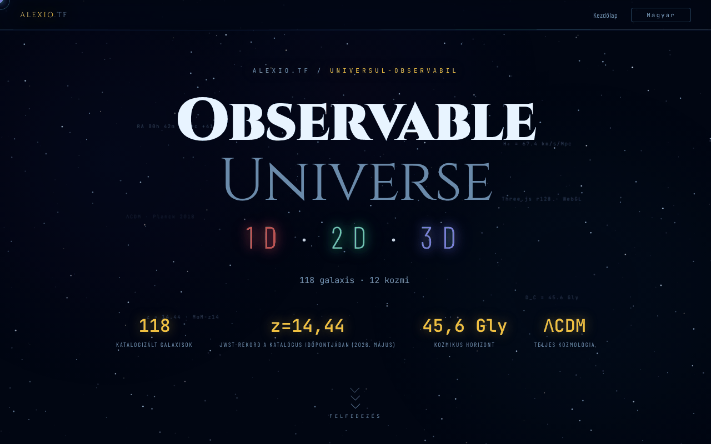

# Observable Universe — 1D · 2D · 3D

[English](README.md) · [Română](README.ro.md) · [Français](README.fr.md) · [Italiano](README.it.md) · [Español](README.es.md) · [Português](README.pt.md) · [Deutsch](README.de.md) · **Magyar**

**Verzió:** 2.1.0 · **Utolsó frissítés:** 2026-10-27

**Állapot:** stabil · **Offline:** teljes (egyetlen fájl; a három alkalmazás a hivatkozásokról indul)

A felület nyelvei: **Română, English, Français, Italiano, Español, Português (PT), Deutsch, Magyar**

Nyitóoldal, amely bemutatja és összehasonlítja a megfigyelhető Világegyetem vizualizációjának három változatát (1D, 2D, 3D).

**Élő változat:** https://chiuta.github.io/Universul-Observabil/

## Mi ez

Ez a HTML-fájl az „Observable Universe" sorozat központi oldala: magukat a vizualizációkat nem tartalmazza (csak egy kis offline kozmológiai számológépet), hanem bemutatja, összehasonlítja és hivatkozza őket. A három változat az oldal leírása szerint:

- 1D (v2.1.0, „Radiális tengely"): 112 galaxis egyetlen tengelyen, négy tengelymóddal (visszatekintési idő, együttmozgó távolság, z vöröseltolódás, skálatényező); kb. 160 KB.
- 2D (v6.2.0, „Síktérkép"): 12 kozmikus horizont, adaptív nagyítás, állapotot tároló állandó hivatkozás, kvíz ranglistával; kb. 550 KB.
- 3D (v2.1.0, „Valódi tér"): valódi rektaszcenzió/deklináció koordináták, ΛCDM kozmológia, H₀-választó (Planck 67,4 és SH0ES 73,0), WebGL Three.js r128-cal; kb. 1 MB.

Az oldal egy 2026 májusában frissített katalógust, valamint a MoM-z14-et (z = 14,44, a JWST-vel spektroszkópiailag megerősítve; Naidu és mtsai, 2025) jelöli meg távolsági rekordként **a katalógus időpontjában (2026. május)**; nem garantáljuk, hogy ezután is rekord marad. A fenti számok az oldal által megadott értékek, itt nem ellenőriztük őket.

## Funkciók

- „Milyen messze, mennyi ideje?": offline kozmológiai számológép (z 0 és 20 között, H₀ = 67,4 Planck vagy 73,0 SH0ES), amely megadja a visszatekintési időt, az együttmozgó távolságot, a Világegyetem korát a kibocsátás pillanatában, az a = 1/(1+z) skálatényezőt, a D_L = (1+z)·D_C fényességi távolságot és a D_A = D_C/(1+z) szögátmérő-távolságot (D_L és D_A a definíciókból következik; z = 1-nél: D_L = 22,19 Gly, D_A = 5,55 Gly); lapos ΛCDM-modell Ωm = 0,315-tel, a sugárzás elhanyagolva (tájékoztató értékek; független integrálással ellenőrizve, pl. z = 1 → 7,95 Gyr és 3,40 Gpc H₀ = 67,4 mellett).
- A három változat bemutatása „Indítás" gombokkal és a GitHubon található másolatokra mutató hivatkozásokkal („GitHub mirror").
- Összehasonlító táblázat kategóriánként (vizualizáció, kozmológia, UX és exportálás, technikai) az 1D / 2D / 3D változatokhoz.
- Nyelvválasztó (RO, EN, FR, IT, ES, PT, DE, HU) az oldal sarkában.
- Buy Me a Coffee hivatkozások.

## Használati útmutató

1. Olvasd el a bemutatót és az összehasonlító táblázatot, hogy kiválaszd a változatot.
2. Nyomd meg a „🔭 3D indítása (ajánlott)", „🌐 2D változat" vagy „📡 1D változat" gombot; mindegyik új lapon nyílik meg az alexio.tf oldalon.
3. Másik lehetőségként használd a „GITHUB MIRRORS" 1D / 2D / 3D hivatkozásokat a chiuta.github.io-n lévő másolatokhoz.
4. A nyelvet az EN / RO gombbal válthatod.

## Adatvédelem és hálózat

- A `localStorage` csak a kiválasztott nyelvet (`universul-observabil.lang`) őrzi meg.
- Az oldal nem indít automatikus hálózati kéréseket (nincs `fetch`, nincsenek külső szkriptek vagy stílusok). A hivatkozások kattintásra az alexio.tf, a chiuta.github.io, a Buy Me a Coffee és a láblécben megjelenő partneroldalak (köztük a centrulstring.ro) felé vezetnek.
- Az elindított változatok önálló alkalmazások, saját szabályzattal; itt nem elemezzük őket.

## Futtatás helyben / offline

Töltsd le az `index.html` fájlt, és nyisd meg böngészőben: az oldal internet nélkül is megjelenik, de az indító gombok és a tükörlinkek kapcsolatot igényelnek, mert online tárolt oldalakra mutatnak.

## A katalógusok mérete a sorozatban (2.0.1)

- **Számok.** Hub: 112 bejegyzés (az 1D katalógus azonos másolata). 1D: 112. 2D: 112 (111 galaxis + a CMB-horizont; egyes szövegek 111-et írnak). 3D: 118 (a leírásokban „több mint 115”). A számok azért térnek el, mert a katalógusok különállóak, nem számolási hiba miatt.
- **Nincs egységesítve.** A 3D saját, eltérő felépítésű katalógust használ (RA órában, más nevek és írásmódok), ezért a nevei csak részben egyeznek az 1D/2D-vel. Egyetlen közös fájlba nem vontuk össze: minden alkalmazás egyetlen offline fájl közös build-lépés nélkül, az összevonás három alkalmazás adatait módosítaná, itt nem validálható módon. Jelezve a szerzőnek.
- **Ismert 1D ↔ 2D ellentmondás (nem javítva, forrásokkal ellenőrizendő).** A két katalógusban ugyanaz a 112 név szerepel, de 8 bejegyzés távolsága eltér (d = visszatekintési idő, millió fényévben, 1D→2D): NGC 1132 330→1020, Perseus (BCG IC 310) 270→780, 3C 48 4150→5200, Abell 370 4200→5900, CL 0024+1654 4400→5500, SDSS J1004+4112 10050→7000, IC 4296 180→130, Abell 1689 2330→7200; az Androméda (M31) vöröseltolódásának előjele az 1D-ben −0,001, a 2D-ben +0,001.

## Real versions and discrepancies (2.1.0)

_(English only; not yet translated into this language. Machine translation intentionally not added to avoid errors in technical statements.)_

- **Card labels** ("v2.1.0 · 112", "v6.2.0 · 112", "v2.1.0 · 118") are no longer stale translation keys: the numbers come from one constant (`UO_APPS`), checked by `tests/versions.test.mjs` against `application-version` in the 1D/2D/3D repositories and against the real entry counts.
- **Catalogue copy** in the hub is compared with 1D (fields `n, ra, dec, d, t, z, lb`): identical.
- **1D ↔ 2D discrepancies** (8 distances and the sign of Andromeda's z) are now in a generated table, `docs/DISCREPANTE.md` (`node tools/compare-catalogs.mjs <1D> <2D> --md docs/DISCREPANTE.md`). **No value was chosen:** NED/SIMBAD were not reachable in the session. The table also shows an internal arithmetic check (the 1D values match the lookback computed from the catalogue's own z; the 2D ones do not), which is **not a source**.
- **Merging the catalogues into one shared file: not done**; it would have required picking one of the conflicting values.

## Előzmények / Changelog

### 2.1.0 — 2026-10-27
- Labels with the real version, version test, `docs/DISCREPANTE.md`.

### 1.2.8 — 2026-10-23
- A `prefers-reduced-motion` beállítást most a JavaScript-animációk is tiszteletben tartják (köd, csillagok csillogása, kattintási részecskék, gépelési effekt, kártyák dőlése, kurzorkövetés, számláló); korábban csak a CSS-animációk csökkentek.
- Kozmikus számológép: csak egyszerű tizedes számokat fogad el (a `0x10`, `1e1`, `0b11` már nem számként értelmeződik).
- Érintőképernyőn (`pointer: coarse`) a hivatkozások, a nyelvválasztó, a chipek és a fülek 44 px-es érintési célpontot kapnak.

### 1.2.7 — 2026-10-23
- fff-kit 1.2.0: a nyelv mostantól a `universul-observabil.lang` kulcs alatt tárolódik; a régi `uo_lang` kulcsot az alkalmazás induláskor automatikusan átköltözteti (régi .fff.json mentés importálása után is). A lábléc verziószövege mostantól minden nyelven a tényleges verziót mutatja.

### 1.2.5 — 2026-10-22
- fff-kit 1.1.4: érintési célpontok és minimális szövegméret; érintési célpontok/szöveg javítva

### 1.2.4 — 2026-10-22
- fff-kit 1.1.2: PBKDF2 600 000 iterációval, clickjacking elleni védelem.

### 1.2.3 — 2026-10-22
- Mobil: a szöveg legalább 12 px, a gombok és mezők érintési felülete pedig nagyobb keskeny képernyőn.

- 1.2.2 — 2026-10-22: Fordítási javítás: az átláthatósági panel leírása (és neve) mostantól a felület nyelvét követi.
- 1.2.1 — 2026-10-22: az oldal címe mostantól követi a felület nyelvét (a <title> nyelvváltáskor frissül).

- 1.1.0 — 2026-10-14: biztonsági mentés és adatcímkézés (fff-kit).

- 1.0.0 — 2026-10-12: a verzió és az utolsó frissítés dátuma megjelenik az alkalmazásban
- 7. kör: a kozmológiai számológép mostantól a skálatényezőt, a fényességi távolságot és a szögátmérő-távolságot is megadja (RO/EN); a fájlméret ~616 KB-ról ~461 KB-ra csökkent 8 fel nem használt @font-face deklaráció eltávolításával (Barlow 300/500/300 dőlt és JetBrains Mono 300), képernyőkép-összehasonlítással és a számított betűtípusok felsorolásával ellenőrizve; tartalomvesztés nélkül.
- Hozzáadva az offline kozmológiai számológép; megszűnt a 2 px-es vízszintes túlnyúlás (az elválasztó vonal); a fejléc dekoratív lebegő címkéi mostantól generált tartalmak (nem okoznak több kontrasztingadozást az axe-core-ban); CSP: `script-src` SHA-256 hash alapján, `'unsafe-inline'` nélkül.
- A galaxisok száma mostantól egységes: 1D és 2D = 112, 3D és a teljes katalógus = 118 (korábban a táblázatban „115+", a fejlécben 118 szerepelt).
- Látható megjegyzés került az oldalra, hogy az csak bemutató jellegű, és a változatok indításához internet kell.
- A fő tartalom a `<main>` elemben van, a dekoratív elemek el vannak rejtve a képernyőolvasók elől, az összehasonlító táblázat és a fülek 360 px-en már nem lógnak túl a képernyőn, a halványított címkék kontrasztja pedig megnőtt; axe-core: 0 szabálysértés 1280 és 360 px-en.
- A MoM-z14 rekord (z = 14,44) továbbra is „a katalógus időpontjában (2026. május)" megfogalmazásban szerepel; a 2026. 10. 11-i keresésben nem találtunk későbbi spektroszkópiai megerősítést, amely felülmúlná, de a dátumozott megfogalmazást szándékosan megtartottuk. 2026. 10. 11-én ellenőrzött források: arXiv 2505.11263 (Naidu és mtsai).

## Licenc

MIT — lásd a LICENSE fájlt

## Audit

Audit: 2026-10-10; 3. kör: 2026-10-11 — az idővel elavuló állítások („JWST-rekord 2026") átfogalmazva: „a katalógus időpontjában (2026. május)", forrással; a 3D leírásából eltávolítottuk a „Zenodo DOI" említését (a 3D alkalmazásnak nincs DOI-ja).

## Szerző

Alexio — Alexandru-Ionuț Chiuță, elérhetőség: alexio@trom.tf. Az oldal lábléce a Centrul StrING-re is hivatkozik.

## Összefoglaló

Egyfájlos nyitóoldal az „Observable Universe" sorozathoz, amely bemutatja és összehasonlítja az 1D, 2D és 3D változatait (radiális tengely, síktérkép, WebGL nézet valódi térben) indító hivatkozásokkal és GitHub-tükrökkel, 8 nyelven, valamint egy kis offline kozmológiai számológép (vöröseltolódás, visszatekintési idő és együttmozgó távolság). Helyben csak a nyelvválasztást tárolja, és nem indít automatikus hálózati kéréseket; az indító és tükörhivatkozások külső oldalakat nyitnak meg.
