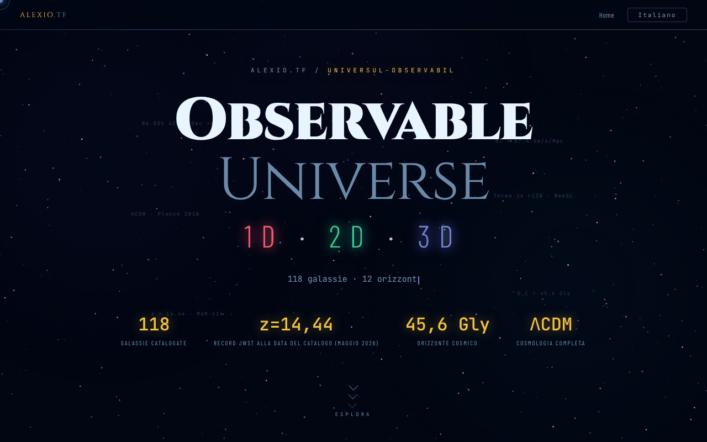

# Observable Universe — 1D · 2D · 3D

[English](README.md) · [Română](README.ro.md) · [Français](README.fr.md) · **Italiano** · [Español](README.es.md) · [Português](README.pt.md) · [Deutsch](README.de.md) · [Magyar](README.hu.md)

**Versione:** 1.2.0 · **Ultimo aggiornamento:** 2026-10-19

Lingue dell'interfaccia: **Română, English, Français, Italiano, Español, Português (PT), Deutsch, Magyar**

Pagina d'ingresso che presenta e confronta le tre versioni (1D, 2D, 3D) della visualizzazione dell'Universo osservabile.

**Online:** https://chiuta.github.io/Universul-Observabil/

## Che cos'è

Questo file HTML è la pagina-hub della serie «Observable Universe»: non contiene le visualizzazioni vere e proprie (ha solo un piccolo calcolatore cosmologico offline), ma le presenta, le confronta e rimanda ad esse. Le tre versioni, secondo la descrizione della pagina:

- 1D (v1.0, «Asse radiale»): 112 galassie su un unico asse, con quattro modalità di asse (tempo di sguardo all'indietro, distanza comovente, redshift z, fattore di scala); circa 160 KB.
- 2D (v5.9, «Mappa piana»): 12 orizzonti cosmici, zoom adattivo, permalink con stato, quiz con classifica; circa 550 KB.
- 3D (v1.2, «Spazio reale»): coordinate AR/Dec reali, cosmologia ΛCDM, selettore di H₀ (Planck 67,4 contro SH0ES 73,0), WebGL con Three.js r128; circa 1 MB.

La pagina indica un catalogo aggiornato a maggio 2026 e MoM-z14 (z = 14,44, confermato spettroscopicamente con il JWST; Naidu et al. 2025) come record di distanza **alla data del catalogo (maggio 2026)**; non garantiamo che resti un record in seguito. Le cifre sopra riportate sono quelle dichiarate dalla pagina, non verificate qui.

## Funzioni

- «Quanto lontano, quanto tempo fa?»: calcolatore cosmologico offline (z tra 0 e 20, H₀ = 67,4 Planck o 73,0 SH0ES) che fornisce il tempo di sguardo all'indietro, la distanza comovente, l'età dell'Universo all'emissione, il fattore di scala a = 1/(1+z), la distanza di luminosità D_L = (1+z)·D_C e la distanza di diametro angolare D_A = D_C/(1+z) (D_L e D_A derivano dalle definizioni; per z = 1: D_L = 22,19 Gal, D_A = 5,55 Gal); modello ΛCDM piatto con Ωm = 0,315, radiazione trascurata (valori indicativi; verificato rispetto a un'integrazione indipendente, ad es. z = 1 → 7,95 Ga e 3,40 Gpc con H₀ = 67,4).
- Presentazione delle tre versioni, con pulsanti «Avvia» e link alle copie su GitHub («GitHub mirror»).
- Tabella comparativa per categorie (visualizzazione, cosmologia, UX ed esportazione, tecnica) per 1D / 2D / 3D.
- Selettore di lingua (RO, EN, FR, IT, ES, PT, DE, HU) nell'angolo della pagina.
- Link Buy Me a Coffee.

## Guida all'uso

1. Leggi la presentazione e la tabella comparativa per scegliere la versione.
2. Premi «🔭 Avvia 3D (consigliata)», «🌐 Versione 2D» o «📡 Versione 1D»; ognuna si apre in una nuova scheda su alexio.tf.
3. In alternativa, usa i link «GITHUB MIRRORS» 1D / 2D / 3D verso le copie su chiuta.github.io.
4. Cambia lingua con il pulsante EN / RO.

## Privacy e rete

- In `localStorage` viene conservata solo la lingua scelta (`uo_lang`).
- La pagina non effettua richieste di rete automatiche (nessun `fetch`, script o stili esterni). I link portano, al clic, ad alexio.tf, chiuta.github.io, Buy Me a Coffee e ai siti partner mostrati nel piè di pagina (tra cui centrulstring.ro).
- Le versioni avviate sono applicazioni distinte, con una propria politica; qui non vengono analizzate.

## Esecuzione locale / offline

Scarica `index.html` e aprilo nel browser: la pagina si visualizza senza internet, ma i pulsanti di avvio e i mirror richiedono una connessione, perché rimandano a pagine ospitate online.

## Cronologia / Changelog

- 1.1.0 — 2026-10-14: copia di sicurezza ed etichettatura dei dati (fff-kit).

- 1.0.0 — 2026-10-12: la versione e la data dell'ultimo aggiornamento sono mostrate nell'app
- Giro 7: il calcolatore cosmologico fornisce ora anche il fattore di scala, la distanza di luminosità e la distanza di diametro angolare (RO/EN); dimensione del file ridotta da ~616 KB a ~461 KB rimuovendo 8 dichiarazioni @font-face inutilizzate (Barlow 300/500/300 corsivo e JetBrains Mono 300), verificata con il confronto di screenshot e l'elenco dei font calcolati; nessuna perdita di contenuto.
- Aggiunto il calcolatore cosmologico offline; eliminato lo sforamento orizzontale di 2 px (la linea di separazione); le etichette fluttuanti decorative dell'intestazione sono ora contenuto generato (non causano più oscillazioni di contrasto in axe-core); CSP: `script-src` tramite hash SHA-256, senza `'unsafe-inline'`.
- Il numero di galassie è ora coerente: 1D e 2D = 112, 3D e catalogo totale = 118 (prima la tabella diceva «115+» e l'intestazione 118).
- Aggiunta una nota visibile che avvisa che la pagina è solo di presentazione e che l'avvio delle versioni richiede internet.
- Il contenuto principale è in `<main>`, gli elementi decorativi sono nascosti agli screen reader, la tabella comparativa e le schede non sforano più lo schermo a 360 px e il contrasto delle etichette attenuate è stato aumentato; axe-core: 0 violazioni a 1280 e 360 px.
- Il record MoM-z14 (z = 14,44) resta formulato «alla data del catalogo (maggio 2026)»; nella ricerca dell'11.10.2026 non abbiamo trovato una conferma spettroscopica successiva che lo superi, ma la formulazione datata è stata mantenuta intenzionalmente. Fonti verificate l'11.10.2026: arXiv 2505.11263 (Naidu et al.).

## Licenza

MIT — vedi il file LICENSE

## Audit

Audit: 2026-10-10; giro 3: 2026-10-11 — affermazioni deperibili («Record JWST 2026») riformulate «alla data del catalogo (maggio 2026)» con la fonte; eliminato il riferimento al «DOI Zenodo» dalla descrizione del 3D (l'app 3D non ha un DOI).

## Autore

Alexio — Alexandru-Ionuț Chiuță, contatto: alexio@trom.tf. Il piè di pagina rimanda anche al Centrul StrING.

## Riepilogo

Una pagina d'ingresso in un unico file per la serie «Observable Universe», che presenta e confronta le versioni 1D, 2D e 3D (asse radiale, mappa piana, vista WebGL nello spazio reale) con link di avvio e mirror GitHub, in 8 lingue, più un piccolo calcolatore cosmologico offline (redshift, tempo di sguardo all'indietro e distanza comovente). Conserva in locale solo la scelta della lingua e non effettua richieste di rete automatiche; i link di avvio e di mirror aprono pagine esterne.
