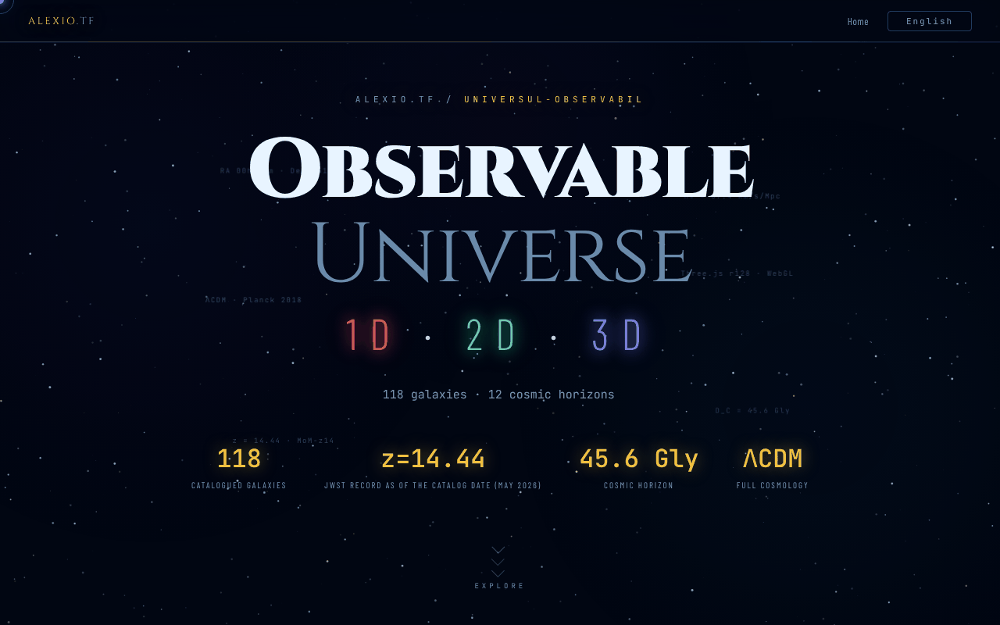

# Observable Universe — 1D · 2D · 3D

**English** · [Română](README.ro.md) · [Français](README.fr.md) · [Italiano](README.it.md) · [Español](README.es.md) · [Português](README.pt.md) · [Deutsch](README.de.md) · [Magyar](README.hu.md)

**Version:** 1.2.6 · **Last updated:** 2026-10-23

Interface languages: **Română, English, Français, Italiano, Español, Português (PT), Deutsch, Magyar**

Landing page that presents and compares the three versions (1D, 2D, 3D) of the observable Universe visualisation.

**Live:** https://chiuta.github.io/Universul-Observabil/

## What it is

This HTML file is the hub page of the "Observable Universe" series: it does not contain the visualisations themselves (it only has a small offline cosmology calculator), but presents them, compares them and links to them. The three versions, as described on the page:

- 1D (v1.0, "Radial Axis"): 112 galaxies on a single axis, with four axis modes (lookback time, comoving, redshift z, scale factor); approx. 160 KB.
- 2D (v5.9, "Flat Map"): 12 cosmic horizons, adaptive zoom, permalink with state, quiz with leaderboard; approx. 550 KB.
- 3D (v1.2, "Real Space"): real RA/Dec coordinates, ΛCDM cosmology, H₀ selector (Planck 67.4 vs. SH0ES 73.0), WebGL with Three.js r128; approx. 1 MB.

The page cites a catalogue updated in May 2026 and MoM-z14 (z = 14.44, spectroscopically confirmed with JWST; Naidu et al. 2025) as the distance record **as of the catalogue date (May 2026)**; we do not guarantee that it remains the record afterwards. The figures above are those declared by the page, not verified here.

## Features

- "How far, how long ago?": an offline cosmology calculator (z between 0 and 20, H₀ = 67.4 Planck or 73.0 SH0ES) that gives the lookback time, comoving distance, age of the Universe at emission, scale factor a = 1/(1+z), luminosity distance D_L = (1+z)·D_C and angular diameter distance D_A = D_C/(1+z) (D_L and D_A follow from the definitions; at z = 1: D_L = 22.19 Gly, D_A = 5.55 Gly); flat ΛCDM model with Ωm = 0.315, radiation neglected (indicative values; checked against an independent integration, e.g. z = 1 → 7.95 Gyr and 3.40 Gpc at H₀ = 67.4).
- Presentation of the three versions, with "Launch" buttons and links to the GitHub copies ("GitHub mirror").
- Comparison table by category (visualisation, cosmology, UX and export, technical) for 1D / 2D / 3D.
- Language selector (RO, EN, FR, IT, ES, PT, DE, HU) in the corner of the page.
- Buy Me a Coffee links.

## User guide

1. Read the presentation and the comparison table to choose a version.
2. Press "🔭 Launch 3D (recommended)", "🌐 2D version" or "📡 1D version"; each one opens in a new tab on alexio.tf.
3. Alternatively, use the "GITHUB MIRRORS" 1D / 2D / 3D links to the copies on chiuta.github.io.
4. Change the language with the EN / RO button.

## Privacy and network

- Only the chosen language (`uo_lang`) is stored in `localStorage`.
- The page makes no automatic network requests (no `fetch`, no external scripts or styles). Links lead, on click, to alexio.tf, chiuta.github.io, Buy Me a Coffee and the partner sites shown in the footer (including centrulstring.ro).
- The launched versions are separate applications with their own policies; they are not analysed here.

## Running locally / offline

Download `index.html` and open it in a browser: the page displays without internet, but the launch buttons and mirrors require a connection, because they point to pages hosted online.

## History / Changelog

### 1.2.5 — 2026-10-22
- fff-kit 1.1.4: touch targets and minimum text size; touch targets/text fixed

### 1.2.4 — 2026-10-22
- fff-kit 1.1.2: PBKDF2 600,000 iterations, anti-clickjacking protection.

### 1.2.3 — 2026-10-22
- Mobile: text is at least 12 px and buttons and fields have larger touch targets on narrow screens.

- 1.2.2 — 2026-10-22: Translation fix: the description (and name) in the transparency panel now follow the interface language.
- 1.2.1 — 2026-10-22: the page title now follows the interface language (<title> updated on language change).

- 1.1.0 — 2026-10-14: Backup and data labelling (fff-kit).

- 1.0.0 — 2026-10-12: the version and the date of the last update are shown in the app
- Round 7: the cosmology calculator now also provides the scale factor, the luminosity distance and the angular diameter distance (RO/EN); file size reduced from ~616 KB to ~461 KB by removing 8 unused @font-face declarations (Barlow 300/500/300 italic and JetBrains Mono 300), verified by screenshot comparison and enumeration of the computed fonts; no loss of content.
- Added the offline cosmology calculator; removed the 2 px horizontal overflow (the separator line); the decorative floating labels in the header are now generated content (they no longer cause contrast fluctuations in axe-core); CSP: `script-src` based on a SHA-256 hash, without `'unsafe-inline'`.
- The number of galaxies is now consistent: 1D and 2D = 112, 3D and the total catalogue = 118 (previously the table said "115+" and the header said 118).
- Added a visible note that the page is for presentation only and that launching the versions requires internet.
- The main content is in `<main>`, decorative elements are hidden from screen readers, the comparison table and the tabs no longer overflow the screen at 360 px, and the contrast of the dimmed labels was increased; axe-core: 0 violations at 1280 and 360 px.
- The MoM-z14 record (z = 14.44) remains worded "as of the catalogue date (May 2026)"; in the search of 11.10.2026 we found no later spectroscopic confirmation that surpasses it, but the dated wording was kept intentionally. Sources checked on 11.10.2026: arXiv 2505.11263 (Naidu et al.).

## License

MIT — see the LICENSE file

## Audit

Audit: 2026-10-10; round 3: 2026-10-11 — perishable claims ("JWST record 2026") reworded "as of the catalogue date (May 2026)" with the source; removed the reference to "Zenodo DOI" from the 3D description (the 3D app has no DOI).

## Author

Alexio — Alexandru-Ionuț Chiuță, contact: alexio@trom.tf. The page footer also links to Centrul StrING.

## Summary

A single-file landing page for the "Observable Universe" series, presenting and comparing its 1D, 2D and 3D versions (radial axis, flat map, real-space WebGL view) with launch links and GitHub mirrors, in 8 languages, plus a small offline cosmology calculator (redshift to lookback time and comoving distance). It stores only the language choice locally and makes no automatic network requests; launch and mirror links open external pages.
