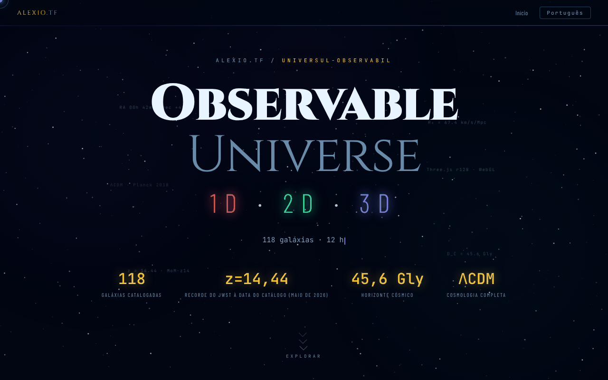

# Observable Universe — 1D · 2D · 3D

[English](README.md) · [Română](README.ro.md) · [Français](README.fr.md) · [Italiano](README.it.md) · [Español](README.es.md) · **Português** · [Deutsch](README.de.md) · [Magyar](README.hu.md)

**Versão:** 1.2.3 · **Última atualização:** 2026-10-22

Idiomas da interface: **Română, English, Français, Italiano, Español, Português (PT), Deutsch, Magyar**

Página de entrada que apresenta e compara as três versões (1D, 2D, 3D) da visualização do Universo observável.

**Online:** https://chiuta.github.io/Universul-Observabil/

## O que é

Este ficheiro HTML é a página-hub da série «Observable Universe»: não contém as visualizações propriamente ditas (tem apenas uma pequena calculadora cosmológica offline), mas apresenta-as, compara-as e remete para elas. As três versões, segundo a descrição da página:

- 1D (v1.0, «Eixo radial»): 112 galáxias num único eixo, com quatro modos de eixo (tempo de retrospeção, distância comóvel, desvio para o vermelho z, fator de escala); cerca de 160 KB.
- 2D (v5.9, «Mapa plano»): 12 horizontes cósmicos, zoom adaptativo, ligação permanente com estado, questionário com classificação; cerca de 550 KB.
- 3D (v1.2, «Espaço real»): coordenadas AR/Dec reais, cosmologia ΛCDM, seletor de H₀ (Planck 67,4 contra SH0ES 73,0), WebGL com Three.js r128; cerca de 1 MB.

A página indica um catálogo atualizado em maio de 2026 e o MoM-z14 (z = 14,44, confirmado espetroscopicamente com o JWST; Naidu et al. 2025) como recorde de distância **à data do catálogo (maio de 2026)**; não garantimos que continue a ser recorde depois disso. Os valores acima são os declarados pela página, não verificados aqui.

## Funcionalidades

- «A que distância, há quanto tempo?»: calculadora cosmológica offline (z entre 0 e 20, H₀ = 67,4 Planck ou 73,0 SH0ES) que indica o tempo de retrospeção, a distância comóvel, a idade do Universo na emissão, o fator de escala a = 1/(1+z), a distância de luminosidade D_L = (1+z)·D_C e a distância de diâmetro angular D_A = D_C/(1+z) (D_L e D_A decorrem das definições; para z = 1: D_L = 22,19 Gal, D_A = 5,55 Gal); modelo ΛCDM plano com Ωm = 0,315, radiação desprezada (valores indicativos; verificado face a uma integração independente, p. ex. z = 1 → 7,95 Ga e 3,40 Gpc com H₀ = 67,4).
- Apresentação das três versões, com botões «Lançar» e ligações para as cópias no GitHub («GitHub mirror»).
- Tabela comparativa por categorias (visualização, cosmologia, UX e exportação, técnica) para 1D / 2D / 3D.
- Seletor de idioma (RO, EN, FR, IT, ES, PT, DE, HU) no canto da página.
- Ligações Buy Me a Coffee.

## Manual de utilização

1. Leia a apresentação e a tabela comparativa para escolher uma versão.
2. Prima «🔭 Lançar 3D (recomendada)», «🌐 Versão 2D» ou «📡 Versão 1D»; cada uma abre num novo separador em alexio.tf.
3. Em alternativa, use as ligações «GITHUB MIRRORS» 1D / 2D / 3D para as cópias em chiuta.github.io.
4. Mude o idioma com o botão EN / RO.

## Privacidade e rede

- Em `localStorage` guarda-se apenas o idioma escolhido (`uo_lang`).
- A página não faz pedidos de rede automáticos (sem `fetch`, nem scripts ou estilos externos). As ligações conduzem, ao clicar, a alexio.tf, chiuta.github.io, Buy Me a Coffee e aos sites parceiros apresentados no rodapé (entre os quais centrulstring.ro).
- As versões lançadas são aplicações separadas, com a sua própria política; não são analisadas aqui.

## Execução local / offline

Descarregue `index.html` e abra-o no navegador: a página é apresentada sem internet, mas os botões de lançamento e os espelhos requerem ligação, porque remetem para páginas alojadas online.

## Histórico / Changelog

### 1.2.3 — 2026-10-22
- Móvel: o texto tem pelo menos 12 px e os botões e campos têm áreas táteis maiores em ecrãs estreitos.

- 1.2.2 — 2026-10-22: Correção de tradução: a descrição (e o nome) do painel de transparência seguem agora o idioma da interface.
- 1.2.1 — 2026-10-22: o título da página acompanha agora o idioma da interface (<title> atualizado ao mudar de idioma).

- 1.1.0 — 2026-10-14: cópia de segurança e etiquetagem de dados (fff-kit).

- 1.0.0 — 2026-10-12: a versão e a data da última atualização são apresentadas na aplicação
- Ronda 7: a calculadora cosmológica fornece agora também o fator de escala, a distância de luminosidade e a distância de diâmetro angular (RO/EN); tamanho do ficheiro reduzido de ~616 KB para ~461 KB com a remoção de 8 declarações @font-face não utilizadas (Barlow 300/500/300 itálico e JetBrains Mono 300), verificado por comparação de capturas e enumeração dos tipos de letra calculados; sem perda de conteúdo.
- Adicionada a calculadora cosmológica offline; eliminado o excesso horizontal de 2 px (a linha separadora); as etiquetas flutuantes decorativas do cabeçalho passaram a ser conteúdo gerado (já não causam flutuações de contraste no axe-core); CSP: `script-src` por hash SHA-256, sem `'unsafe-inline'`.
- O número de galáxias é agora consistente: 1D e 2D = 112, 3D e catálogo total = 118 (antes, a tabela dizia «115+» e o cabeçalho 118).
- Adicionada uma nota visível de que a página é apenas de apresentação e de que o lançamento das versões requer internet.
- O conteúdo principal está em `<main>`, os elementos decorativos estão ocultos dos leitores de ecrã, a tabela comparativa e os separadores já não excedem o ecrã a 360 px e o contraste das etiquetas atenuadas foi aumentado; axe-core: 0 violações a 1280 e 360 px.
- O recorde MoM-z14 (z = 14,44) continua formulado «à data do catálogo (maio de 2026)»; na pesquisa de 11.10.2026 não encontrámos confirmação espetroscópica posterior que o supere, mas a formulação datada foi mantida intencionalmente. Fontes verificadas a 11.10.2026: arXiv 2505.11263 (Naidu et al.).

## Licença

MIT — ver o ficheiro LICENSE

## Auditoria

Auditoria: 2026-10-10; ronda 3: 2026-10-11 — afirmações perecíveis («Recorde JWST 2026») reformuladas «à data do catálogo (maio de 2026)» com a fonte; removida a referência ao «DOI Zenodo» da descrição do 3D (a aplicação 3D não tem DOI).

## Autor

Alexio — Alexandru-Ionuț Chiuță, contacto: alexio@trom.tf. O rodapé da página remete também para o Centrul StrING.

## Resumo

Página de entrada de ficheiro único para a série «Observable Universe», que apresenta e compara as suas versões 1D, 2D e 3D (eixo radial, mapa plano, vista WebGL em espaço real) com ligações de lançamento e espelhos do GitHub, em 8 idiomas, além de uma pequena calculadora cosmológica offline (desvio para o vermelho, tempo de retrospeção e distância comóvel). Guarda localmente apenas a escolha do idioma e não faz pedidos de rede automáticos; as ligações de lançamento e de espelho abrem páginas externas.
