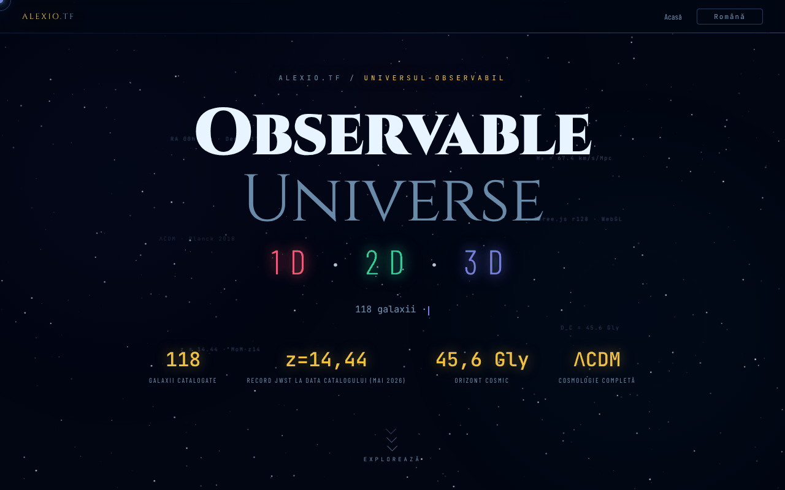

# Observable Universe — 1D · 2D · 3D

[English](README.md) · **Română** · [Français](README.fr.md) · [Italiano](README.it.md) · [Español](README.es.md) · [Português](README.pt.md) · [Deutsch](README.de.md) · [Magyar](README.hu.md)

**Versiune:** 2.1.3 · **Ultima actualizare:** 2026-10-31

**Stare:** stabil · **Offline:** complet (un singur fișier; cele trei aplicații se lansează din linkuri)

Limbile interfeței: **Română, English, Français, Italiano, Español, Português (PT), Deutsch, Magyar**

Pagină de intrare care prezintă și compară cele trei versiuni (1D, 2D, 3D) ale vizualizării Universului observabil.

**Live:** https://chiuta.github.io/Universul-Observabil/

## Ce este

Acest fișier HTML este pagina-hub a seriei „Observable Universe": nu conține vizualizările în sine (are doar un mic calculator cosmologic offline), ci le prezintă, le compară și trimite către ele. Cele trei versiuni, după descrierea din pagină:

- 1D (v2.1.2, „Axa Radială"): 112 galaxii pe o singură axă, cu patru moduri de axă (lookback time, comoving, redshift z, factor de scară); aprox. 160 KB.
- 2D (v6.2.2, „Harta Plană"): 12 orizonturi cosmice, zoom adaptiv, permalink cu stare, quiz cu leaderboard; aprox. 550 KB.
- 3D (v2.1.1, „Spațiu Real"): coordonate RA/Dec reale, cosmologie ΛCDM, selector H₀ (Planck 67,4 vs. SH0ES 73,0), WebGL cu Three.js r128; aprox. 1 MB.

Pagina indică un catalog actualizat în mai 2026 și MoM-z14 (z = 14,44, confirmat spectroscopic cu JWST; Naidu et al. 2025) drept recordul de distanță **la data catalogului (mai 2026)**; nu garantăm că rămâne record ulterior. Cifrele de mai sus sunt cele declarate de pagină, nu verificate aici.

## Funcții

- „Cât de departe, cât de demult?”: calculator cosmologic offline (z între 0 și 20, H₀ = 67,4 Planck sau 73,0 SH0ES) care dă timpul de privire înapoi, distanța comobilă, vârsta Universului la emisie, factorul de scară a = 1/(1+z), distanța de luminozitate D_L = (1+z)·D_C și distanța de diametru unghiular D_A = D_C/(1+z) (D_L și D_A urmează din definiții; la z = 1: D_L = 22,19 Gly, D_A = 5,55 Gly); model ΛCDM plat cu Ωm = 0,315, radiația neglijată (valori orientative; verificat față de o integrare independentă, de ex. z = 1 → 7,95 Gyr și 3,40 Gpc la H₀ = 67,4).
- Prezentare a celor trei versiuni, cu butoane „Lansează" și linkuri către copiile de pe GitHub („GitHub mirror").
- Tabel comparativ pe categorii (vizualizare, cosmologie, UX și export, tehnic) 1D / 2D / 3D.
- Selector de limbă (RO, EN, FR, IT, ES, PT, DE, HU) în colțul paginii.
- Linkuri Buy Me a Coffee.

- **Explorator unificat 1D · 2D · 3D** (v2.0): catalogul celor 112 de obiecte din aplicația 1D este înglobat în pagină; alegi o galaxie în oricare dintre cele trei vederi (axa lookback, harta după RA/distanță, nor 3D rotativ cu RA/Dec reale) sau din listă și o vezi evidențiată în celelalte două, cu același calculator cosmologic ca în secțiunea Calculator. Cardul compară două modele (Planck 2018, H₀ = 67,4 față de SH0ES, H₀ = 73,0) și arată diferențele; calculatorul are un mod de comparare cu același tabel. Legături spre 1D și 2D cu galaxia aleasă; 3D se deschide fără selecție (aplicația 3D nu are încă legătură pentru o galaxie). Permalink `#x=<număr>`.

## Manual de utilizare

1. Citește prezentarea și tabelul comparativ pentru a alege versiunea.
2. Apasă „🔭 Lansează 3D (recomandat)", „🌐 Versiunea 2D" sau „📡 Versiunea 1D"; fiecare se deschide într-o filă nouă pe alexio.tf.
3. Alternativ, folosește linkurile „GITHUB MIRRORS" 1D / 2D / 3D către copiile de pe chiuta.github.io.
4. Schimbă limba cu butonul EN / RO.

## Confidențialitate și rețea

- În `localStorage` se reține doar limba aleasă (`universul-observabil.lang`).
- Pagina nu face cereri automate de rețea (fără `fetch`, scripturi sau stiluri externe). Linkurile duc, la click, către alexio.tf, chiuta.github.io, Buy Me a Coffee și site-urile partenere afișate în subsol (printre care centrulstring.ro).
- Versiunile lansate sunt aplicații separate, cu propria politică; ele nu sunt analizate aici.

## Rulare locală / offline

Descarcă `index.html` și deschide-l în browser: pagina se afișează fără internet, dar butoanele de lansare și mirror-urile cer conexiune, pentru că trimit către pagini găzduite online.

## Mărimea cataloagelor în serie (2.0.1)

- **Numere.** Hub: 112 intrări (copie identică a catalogului 1D). 1D: 112. 2D: 112 (111 galaxii + orizontul CMB; unele texte spun 111). 3D: 118 („peste 115” în descrieri). Cifrele diferă pentru că cataloagele sunt separate, nu dintr-o eroare de numărare.
- **Neunificate.** 3D are catalogul propriu, într-o structură diferită (RA în ore, alte nume și grafii), așa că numele se potrivesc doar parțial cu 1D/2D. Unificarea într-un singur fișier comun nu s-a făcut: fiecare aplicație este un singur fișier offline, fără pas de build comun, iar îmbinarea ar schimba datele în trei aplicații fără cum să fie validată aici. Semnalat autorului.
- **Conflict 1D ↔ 2D (rezolvat la 2026-10-28; surse și formule în `docs/DISCREPANTE.md` din hub).** Cele 8 distanțe (NGC 1132, IC 310, 3C 48, Abell 370, CL 0024+1654, SDSS J1004+4112, IC 4296, Abell 1689) urmează acum aceeași convenție în ambele aplicații: d = lb = lookback(z), în Mly, ΛCDM plat Planck 2018 (H₀ = 67,4, Ωm = 0,315), cu z confirmat de cel puțin 2 surse; 2D a preluat valorile din 1D (330, 270, 4150, 4200, 4400, 10050, 180, 2330). Redshift-ul Andromedei (M31) este −0,001 în ambele (M31 este spre albastru, −301 km/s). Eticheta „Perseus (BCG IC 310)” a devenit „IC 310 (Perseus)”: IC 310 nu este cea mai strălucitoare galaxie a roiului (aceea este NGC 1275, intrare separată).

## Versiuni reale și discrepanțe (2.1.0)

- **Etichetele cardurilor** („v2.1.0 · 112”, „v6.2.0 · 112”, „v2.1.0 · 118”) nu mai sunt chei de traducere învechite: numerele vin dintr-o singură constantă (`UO_APPS`), verificată de `tests/versions.test.mjs` față de `application-version` din depozitele 1D/2D/3D și față de numărul real de intrări.
- **Copia catalogului** din hub este comparată cu 1D (câmpurile `n, ra, dec, d, t, z, lb`): identică.
- **Discrepanțele 1D ↔ 2D** (8 distanțe și semnul z al Andromedei) sunt acum într-un tabel generat, `docs/DISCREPANTE.md` (`node tools/compare-catalogs.mjs <1D> <2D> --md docs/DISCREPANTE.md`). **Nicio valoare nu a fost aleasă:** NED/SIMBAD nu erau accesibile în sesiune. Tabelul arată și o verificare aritmetică internă (valorile 1D coincid cu lookback-ul calculat din z-ul din catalog; cele 2D nu), care **nu este o sursă**.
- **Unificarea cataloagelor într-un fișier comun: nu s-a făcut**; ar fi presupus alegerea uneia dintre valorile în conflict.

## Istoric / Changelog

### 2.1.2 — 2026-10-28
- Copia din hub urmează 1D (7 distanțe, NGC 1277, „Abell 2744 (Pandora)”); `docs/DISCREPANTE.md` regenerat; `tests/catalog-consistency.test.mjs` extins (surse, intrări neschimbate, audit z > 0,01); cardurile arată 1D 2.1.2 / 2D 6.2.2 / 3D 2.1.1.

### 2.1.1 — 2026-10-28
- Corecții de catalog: copia din hub urmează 1D (eticheta „IC 310 (Perseus)”); cele 8 distanțe și semnul z al Andromedei sunt rezolvate cu surse în `docs/DISCREPANTE.md` (generator `tools/compare-catalogs.mjs`); test nou `tests/catalog-consistency.test.mjs`; cardurile arată 1D 2.1.1 / 2D 6.2.1 / 3D 2.1.1.

### 2.1.0 — 2026-10-27
- Etichete cu versiunea reală, test de versiuni, `docs/DISCREPANTE.md`.

### 2.0.0 — 2026-10-26
- Explorator unificat 1D·2D·3D cu selecție sincronă și compararea a două modele cosmologice (Planck ↔ SH0ES), și în calculator.

### 1.2.8 — 2026-10-23
- `prefers-reduced-motion` este acum respectat și de animațiile din JavaScript (nebuloasă, sclipirea stelelor, particulele la clic, efectul de tastare, înclinarea cardurilor, urmărirea cursorului, contorul); înainte erau reduse doar animațiile CSS.
- Calculatorul cosmic: se acceptă doar zecimale simple (`0x10`, `1e1`, `0b11` nu mai sunt citite ca numere).
- Pe ecrane tactile (`pointer: coarse`) legăturile, selectorul de limbă, chip-urile și taburile au o țintă tactilă de 44 px.

### 1.2.7 — 2026-10-23
- fff-kit 1.2.0: limba se păstrează acum sub cheia `universul-observabil.lang`; vechea cheie `uo_lang` este migrată automat la pornire (și după importul unei copii .fff.json vechi). Textul versiunii din subsol urmează acum versiunea reală în toate limbile.

### 1.2.5 — 2026-10-22
- fff-kit 1.1.4: ținte tactile și text minim; ținte tactile/text corectate

### 1.2.4 — 2026-10-22
- fff-kit 1.1.2: PBKDF2 600 000 de iterații, protecție anti-clickjacking.

### 1.2.3 — 2026-10-22
- Mobil: textul are cel puțin 12 px, iar butoanele și câmpurile au ținte tactile mai mari pe ecrane înguste.

- 1.2.2 — 2026-10-22: Fix de traducere: descrierea (și numele) din panoul de transparență urmează acum limba interfeței.
- 1.2.1 — 2026-10-22: titlul paginii urmează acum limba interfeței (<title> se actualizează la schimbarea limbii).

- 1.1.0 — 2026-10-14: Copie de rezervă și etichetare date (fff-kit).

- 1.0.0 — 2026-10-12: versiunea și data ultimei actualizări sunt afișate în aplicație
- Runda 7: calculatorul cosmologic oferă acum și factorul de scară, distanța de luminozitate și distanța de diametru unghiular (RO/EN); dimensiunea fișierului redusă de la ~616 KB la ~461 KB prin eliminarea a 8 declarații @font-face nefolosite (Barlow 300/500/300 italic și JetBrains Mono 300), verificat prin comparație de capturi și enumerarea fonturilor calculate; fără pierdere de conținut.
- Adăugat calculatorul cosmologic offline; eliminat depășirea orizontală de 2 px (linia separatoare); etichetele plutitoare decorative din antet sunt acum conținut generat (nu mai produc fluctuații de contrast în axe-core); CSP: `script-src` pe hash SHA-256, fără `'unsafe-inline'`.
- Numărul de galaxii este acum consecvent: 1D și 2D = 112, 3D și catalogul total = 118 (înainte, tabelul spunea „115+”, iar antetul 118).
- Adăugată o notă vizibilă că pagina e doar de prezentare și lansarea versiunilor cere internet.
- Conținutul principal este în `<main>`, elementele decorative sunt ascunse cititoarelor de ecran, tabelul comparativ și filele nu mai depășesc ecranul la 360 px, iar contrastul etichetelor estompate a fost crescut; axe-core: 0 violări la 1280 și 360 px.
- Recordul MoM-z14 (z = 14,44) rămâne formulat „la data catalogului (mai 2026)”; nu am găsit în căutarea din 11.10.2026 o confirmare spectroscopică ulterioară care să-l depășească, dar formularea cu dată a fost păstrată intenționat. Surse verificate la 11.10.2026: arXiv 2505.11263 (Naidu et al.).

## Licență

MIT — vezi fișierul LICENSE

## Audit

Audit: 2026-10-10; runda 3: 2026-10-11 — afirmațiile perisabile („Record JWST 2026") reformulate „la data catalogului (mai 2026)" cu sursa; eliminată trimiterea la „DOI Zenodo" din descrierea 3D (aplicația 3D nu are DOI).

## Autor

Alexio — Alexandru-Ionuț Chiuță, contact: alexio@trom.tf. Subsolul paginii face trimitere și la Centrul StrING.

## Rezumat

O pagină de întâmpinare într-un singur fișier pentru seria „Universul Observabil”, care prezintă și compară versiunile sale 1D, 2D și 3D (axă radială, hartă plană, vedere WebGL în spațiu real), cu linkuri de lansare și oglinzi GitHub, în 8 limbi, plus un mic calculator cosmologic offline (deplasare spre roșu în timp de privire înapoi și distanță comobilă). Stochează local doar limba aleasă și nu face cereri de rețea automate; linkurile de lansare și de oglindă deschid pagini externe.
